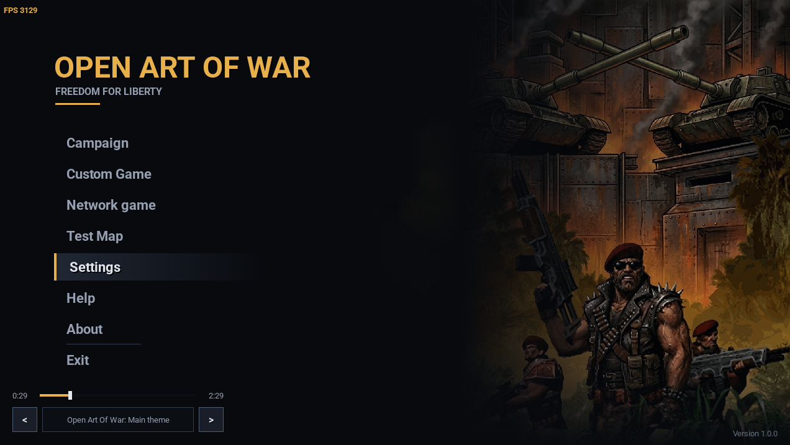
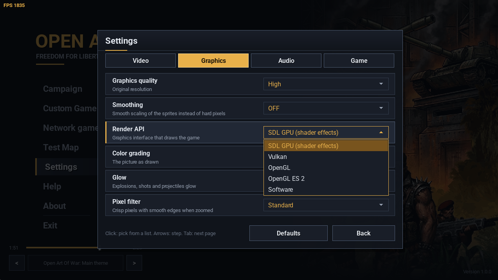
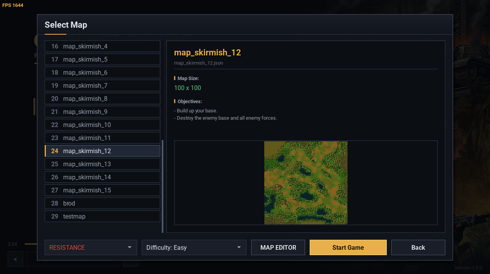
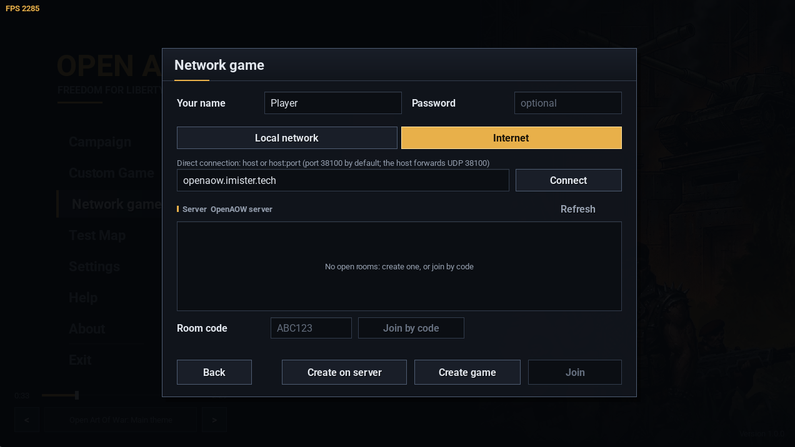
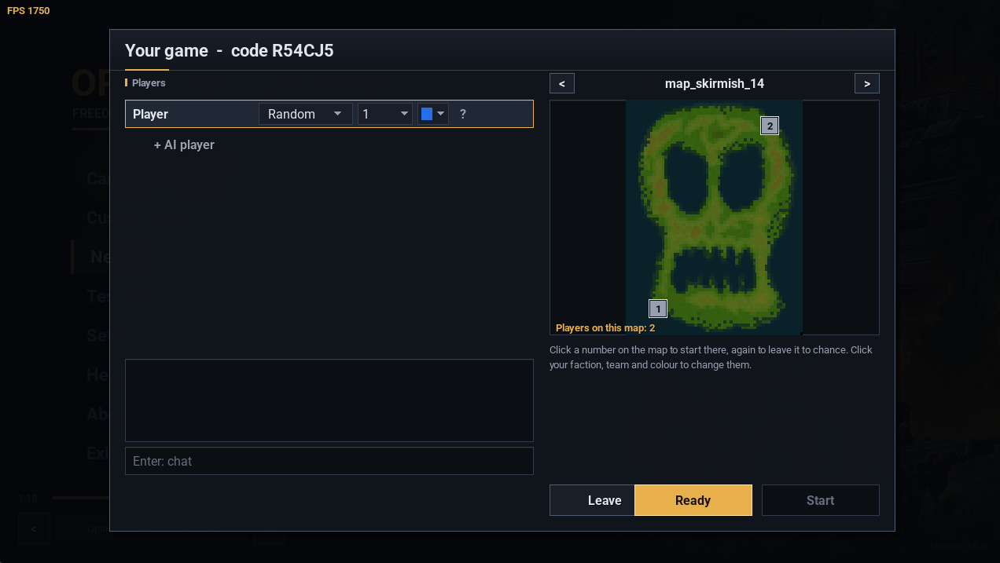

# Open Art Of War: Freedom for Liberty

A native, open-source, **cross-platform real-time strategy game** recreating **Art of War 2: Liberation of Peru** for **Linux, Windows, macOS and Android**. Build your base, command the Resistance or Confederation, and play campaigns or skirmishes against the AI. **LAN and online multiplayer support up to eight players**, with teams, direct connections and dedicated server rooms.

[](https://github.com/badcast/open-art-of-war/actions)
[](#platforms)
[](LICENSE)

[Website](https://openaow.imister.tech) · [Downloads](https://github.com/badcast/open-art-of-war/releases) · [Report an issue](https://github.com/badcast/open-art-of-war/issues) · [Telegram](https://t.me/+EkC17x8nKy05NDdi)

> **In active development.** The game is being developed and tested. A **fan-made asset pack is also in development**, with original graphics and UI artwork still being designed. Game artwork and audio are separate from the engine; see [Game assets](#game-assets) before playing.



**On this page:** [Features](#features) · [Platforms](#platforms) · [Build & run](#build--run) · [Controls](#controls) · [Multiplayer](#multiplayer) · [Documentation](#documentation) · [Contributing](#contributing)

<details>
<summary>Кратко по-русски</summary>

**Open Art Of War** — открытое воссоздание классической стратегии Art of War 2 для Linux, Windows, macOS и Android. Доступны кампании за две стороны, бои с компьютером, сетевая игра до восьми игроков и редакторы.

Проект находится в разработке и тестировании. Графика и звук оригинальной игры не входят в лицензию движка. Перед запуском необходимо подготовить игровые ресурсы.

На Android добавлены альбомная ориентация, масштабирование интерфейса, крупные вкладки HUD и сенсорное управление. Инструкции по сборке, установке ресурсов и жестам находятся в [Android README](android-setup/README.md).

Помочь проекту можно кодом, тестированием, переводами, графикой и звуком. Задачи обсуждаем в Issues и чате Telegram, ссылки — в начале страницы.

</details>

## Features

- **Two factions and campaigns:** Resistance — *Liberation of Peru*; Confederation — *Global Confederation*.
- **Skirmishes and multiplayer:** custom maps, computer opponents, teams and up to eight players; LAN discovery, direct connections and server rooms.
- **Classic RTS gameplay:** base building, power, economy, research, fog of war, attack-move and control groups.
- **Desktop and touch controls:** mouse and keyboard on desktop; touch selection, contextual commands, camera gestures and a landscape HUD on Android.
- **Configurable graphics:** zoom, quality settings, renderer fallback and shader effects where supported.
- **Creation tools:** map and character editors, configurable game data, mods and replay support.

<details>
<summary>More screenshots</summary>

| Gameplay | Maps |
| --- | --- |
|  |  |
|  |  |

</details>

## Platforms

| Platform | Build and interface |
| --- | --- |
| Linux | Native desktop build with mouse and keyboard |
| Windows | Native desktop build with MSVC or MinGW |
| macOS | Native desktop build |
| Android | Android 7.0+; ARM64 and x86_64; fullscreen landscape with touch controls |

The Android project is in [`android-setup/`](android-setup/README.md). Its platform-specific code uses `#if ANDROID`; CMake defines `ANDROID=1` for Android and `ANDROID=0` for desktop builds.

## Build & run

### Game assets

The engine needs game data, artwork and audio. Original Art of War 2 assets belong to Gear Games and are **not covered by the engine's GPLv3 license**. A **fan-made asset pack is in development**: its graphics and UI artwork are still in the design phase, and it is not yet a complete, ready-to-play replacement. Until it is ready, use assets from your legally obtained copy of the original game or another compatible asset pack.

On desktop, place the prepared `assets/` directory in the repository root, or put `assets.blob` beside the executable. The default archive name is **`assets.blob`**.

To pack an existing `assets/` directory during a desktop build, add `-DBUILD_ASSETS_BLOB=ON` to the configure command. Android reads this archive from the application's storage directory; see the [Android asset instructions](android-setup/README.md#game-assets).

### Desktop dependencies

The project uses a C++17 compiler, CMake and SDL3. Install the development packages for your platform:

| Platform | Dependencies |
| --- | --- |
| Arch Linux | `base-devel cmake ninja sdl3 sdl3_ttf yaml-cpp nlohmann-json gettext libarchive zstd pkgconf python` |
| Windows / MSVC | vcpkg packages: `sdl3 sdl3-ttf yaml-cpp nlohmann-json gettext-libintl libarchive[zstd] pkgconf` |
| Windows / MinGW | MSYS2 MINGW64 packages: `toolchain cmake ninja SDL3 SDL3_ttf yaml-cpp nlohmann-json libarchive zstd gettext-runtime gettext-tools` |
| macOS | Homebrew packages: `cmake ninja sdl3 sdl3_ttf yaml-cpp nlohmann-json gettext libarchive zstd pkgconf spirv-cross` |

Networking, debugging UI and audio-decoding dependencies are bundled in `3rdParty/`. Shader compilation uses `glslc` when available, otherwise the precompiled shaders are used. Platform-specific toolchain setup is recorded in the [desktop build workflow](.github/workflows/build.yml).

### Build the desktop game

From the repository root, after installing dependencies and configuring your compiler environment:

```bash
cmake -S . -B build -G Ninja -DCMAKE_BUILD_TYPE=Release
cmake --build build --parallel
./build/openaow
```

On Windows, run `build\openaow.exe`. MSVC builds also need the vcpkg toolchain passed at configuration time; see the workflow above.

The desktop build also produces `openaow-server`, `openaow-mapeditor` and `openaow-charactereditor`. Use `-DOAOW_BUILD_SERVER=OFF` if the server is not needed.

### Build for Android

Open `android-setup/` in Android Studio, or build with an installed Gradle, JDK 17, Android SDK and NDK:

```bash
cd android-setup
gradle assembleDebug
```

The APK is written to `android-setup/app/build/outputs/apk/debug/` relative to the repository root. Install it and provide `assets.blob` separately.

See the [Android setup guide](android-setup/README.md) for prerequisites and asset installation. The [Android build workflow](.github/workflows/android.yml) contains the CI setup, including SDL Java sources.

### Useful launch options

```bash
./build/openaow --map=m26                 # Start a custom game
./build/openaow --map=m26 --from-scratch  # Start with HQ and power plant
./build/openaow --testmap                 # Open the test map
./build/openaow --replay=match.awr         # Watch a replay
./build/openaow --renderer=opengl         # Override the renderer for this run
./build/openaow --help                    # List all options
```

## Controls

### Desktop

| Action | Input |
| --- | --- |
| Select units | Left-click or drag a selection box |
| Move / attack / set rally point | Right-click |
| Assign / recall a control group | `Ctrl+1..0` / `1..0` |
| Attack-move | `Q`, then left-click the destination |
| Toggle siege mode | `G` |
| Move camera | `W A S D`, arrow keys or middle-button drag |
| Zoom map | Mouse wheel over the map |
| Move camera using radar | Click or drag on the radar |
| Zoom radar | Radar `+` / `−` buttons or mouse wheel |
| Build, recruit, research, issue orders | Command sidebar |
| Open game menu | `Escape` |
| Toggle fullscreen | `F11` or `Alt+Enter` |
| Pause a network match | `P` or `Pause` |

### Android

| Action | Gesture |
| --- | --- |
| Select a unit / activate a button | Tap |
| Select several units | Drag with one finger on the map |
| Move / attack / set rally point | Hold for at least 0.5 seconds, then release |
| Cancel a production order | Hold its production card, then release |
| Move and zoom the camera | Drag or pinch with two fingers |
| Switch HUD tabs | Tap the labelled sidebar buttons |
| Back / game menu | System Back button |

The interface scales with the screen and stays in landscape orientation. Camera gestures are disabled while menus are open.

## Multiplayer

Choose **Network game** from the main menu and enter a player name.

| Connection | How to play |
| --- | --- |
| LAN | Create a game or join one found on the local network |
| Direct connection | Enter the host's address, optionally with `:port`; the host needs an accessible UDP port |
| Server room | Create or join a room through the configured server; port forwarding is not needed |
| Join code | Enter the room's six-character code |

The host chooses the map and computer opponents. Players choose their faction, team, colour and start position, then mark themselves ready. Missing maps are transferred through the lobby.

Opening the game menu does not pause a network match. The game supports reconnecting and checks simulation consistency between peers.

<details>
<summary>Command-line examples and dedicated server</summary>

```bash
# Host and join a LAN game
./build/openaow --host=38100 --players=2 --map=m26 --name=Alice
./build/openaow --join=192.168.1.10:38100 --name=Bob

# Create or join a server room
./build/openaow --server=openaow.imister.tech --server-create --players=2 --map=m26
./build/openaow --server=openaow.imister.tech --server-code=ABC234

# Run a dedicated server
./build/openaow-server --name "My server"
./build/openaow-server --help
```

The server needs no graphics or game assets. Default ports are UDP `38100` for discovery and room access, UDP `38110–38199` for rooms, and TCP `38100` for the HTTP status endpoint. See the [systemd service example](openaow-server/openaow-server.service) for Linux hosting.

The simulation uses deterministic lockstep: players exchange commands and each peer simulates the world. Network defaults are configured in `assets/data/game_environment.json`.

</details>

## Settings & saved data

Open **Settings** from the main menu or game menu to adjust graphics, audio, language and zoom. Desktop builds also offer window modes and display resolutions; Android uses the fullscreen device surface.

The game stores preferences and progress in its per-user application directory, separate from the factory data in `assets/`:

| File or directory | Purpose |
| --- | --- |
| `settings.json` | Preferences, player details and renderer settings |
| `savegame.json` | Campaign progress |
| `downloaded_maps/` | Maps received in multiplayer |
| `replays/` | Recorded network games |

## Documentation

| Guide | Contents |
| --- | --- |
| [Android](android-setup/README.md) | Build setup, assets, touch controls and device checks |
| [Tests & debugging](TESTS.md) | Test suites, debug builds and diagnostic tools |
| [Architecture](docs/architecture.md) | Engine structure and simulation |
| [Map editor](openaow-mapeditor/README.md) | Map creation and editing |
| [Character editor](openaow-charactereditor/README.md) | Unit and building configuration |
| [Modding](docs/modding.md) | Custom game content |
| [Replay format](docs/replay-format.md) | Replay file structure |
| [Binary formats](docs/binary_formats.md) | Resource formats |

Run tests after building:

```bash
ctest --test-dir build --output-on-failure
```

Tests do not generally require the in-game debugger; some need game assets. To enable debug tools, configure a **separate** build:

```bash
cmake -S . -B build-debug -G Ninja -DCMAKE_BUILD_TYPE=Release -DAOW_DEBUG=ON
cmake --build build-debug --parallel
./build-debug/openaow --debug
```

## Contributing

Contributions are welcome in gameplay, networking, Android support, UI, testing, translations, original artwork and audio.

Start with an issue describing the problem or proposal, then submit a focused pull request with verification steps. For bugs, include your platform, build version, reproduction steps and relevant logs. Use the community links at the top of this page to discuss work with other contributors.

<details>
<summary>Why this project exists</summary>

Art of War 2 was a favourite on classic Nokia phones. Inspired by Command & Conquer, OpenRA and Warzone 2100, this project brings that portable RTS experience to modern systems while keeping its base building, factions and tactical gameplay.

Thanks to the original creators and to everyone helping give the game a second life.

</details>

## License & credits

The engine, tools and editors are licensed under [GNU GPLv3](LICENSE). Bundled third-party libraries retain their own licenses.

**Art of War 2: Liberation of Peru**, its original code, artwork, audio and trademarks belong to **Gear Games**. This is an independent recreation and is not affiliated with or endorsed by Gear Games. Original proprietary assets are not covered by this project's source-code license.
