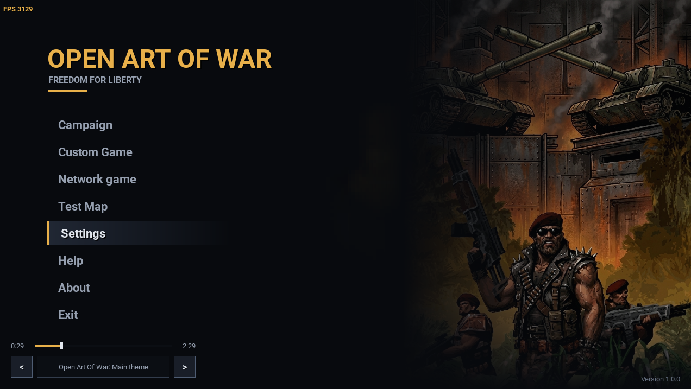
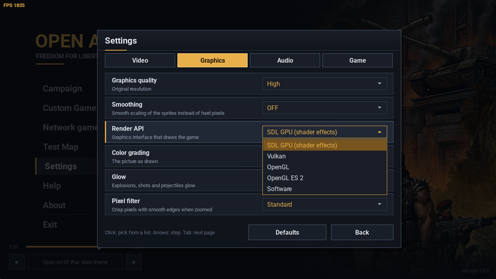
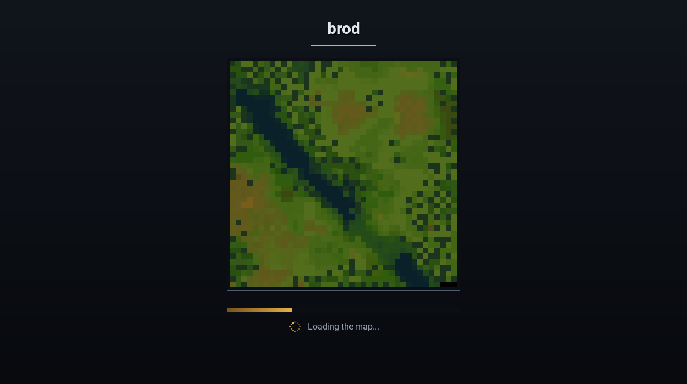
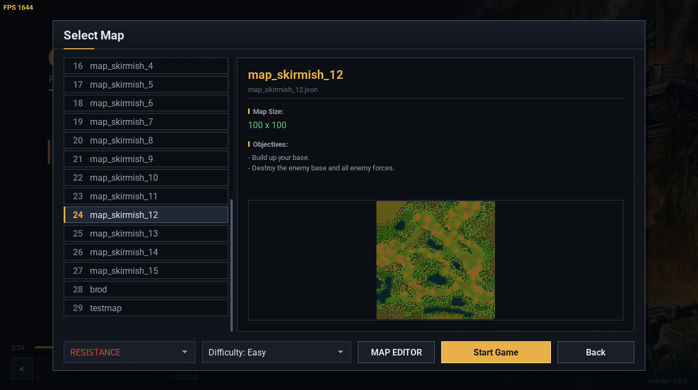
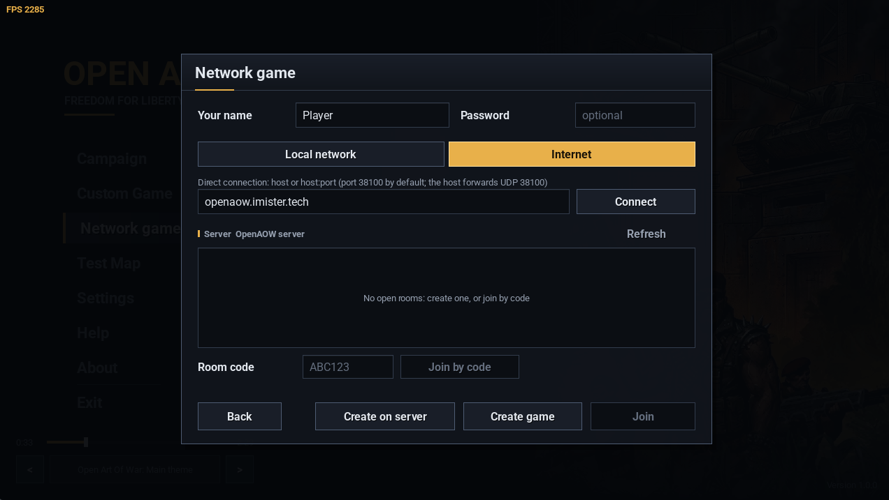
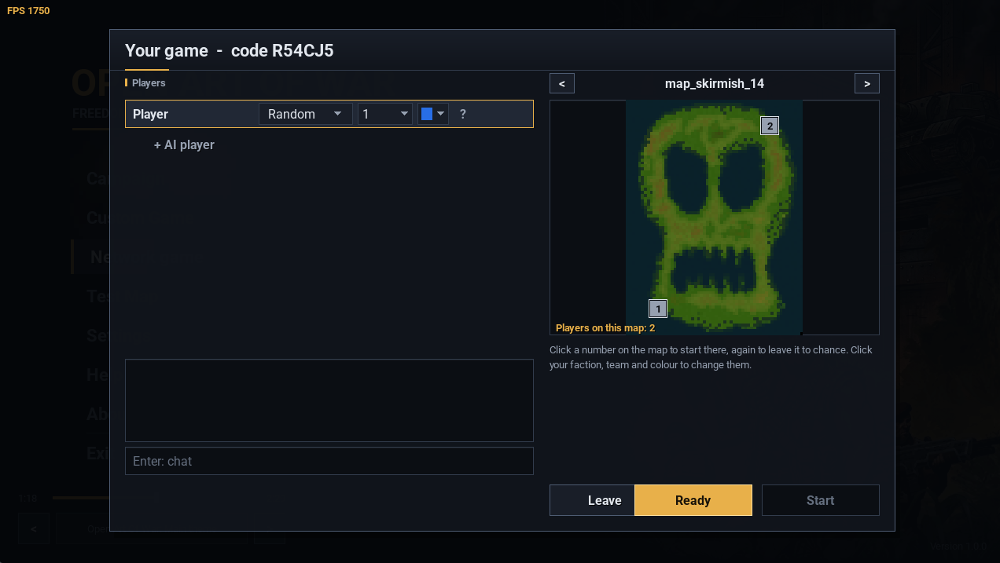

# Open Art Of War: Freedom for Liberty

[](https://github.com/badcast/open-art-of-war/actions)
[](https://github.com/badcast/open-art-of-war/stargazers)
[](LICENSE)
[%20%7C%20macOS-informational?style=flat-square)](#building)

[](https://en.cppreference.com/w/cpp/17)
[](https://libsdl.org/)
[](#render-api)
[](https://cmake.org/)
[](#debugger)
[](#network-game)
[](#directory-structure)

A native desktop port of the classic mobile RTS **"Art of War 2: Liberation of Peru"** (Gear Games, MIDP-2.0 / CLDC-1.0), reverse-engineered and rebuilt in **C++17** on **SDL3**, with network play for up to eight players, a dedicated server and shader effects. Runs on Linux, Windows (MSVC, MinGW) and macOS.

| <div align="center"><b>English (EN)</b></div> | <div align="center"><b>Русский (RUS)</b></div> |
| :---: | :---: |
| <div align="center"><font color="#e03131"><b>⚠️ WARNING: PROJECT IS IN ACTIVE TESTING ⚠️<br><br>The game is currently under active development and testing.<br>If you wish, you can compile it yourself by following the section below:<br>👉 <a href="#building">Building Instructions</a>.<br><br>🎨 The fan-made asset pack (graphics & UI) is still in the design phase.<br>To play immediately without waiting, you can extract assets from the original game archive (<code>aow2.jar</code>) using the converters in <code>tools/</code>.<br><br><i>Disclaimer: Open Art of War is licensed under GPLv3, but original art, sprites, and audio belong to Gear Games. Extracting assets from a legally owned <code>aow2.jar</code> runs locally on your machine strictly for software preservation and interoperability.</i></b></font></div> | <div align="center"><font color="#e03131"><b>⚠️ ВНИМАНИЕ: ПРОЕКТ В СТАДИИ ТЕСТИРОВАНИЯ ⚠️<br><br>Игра находится в активной разработке и тестировании.<br>При желании вы можете собрать проект сами по инструкции ниже:<br>👉 <a href="#building">Инструкция по сборке (Building)</a>.<br><br>🎨 Фанатский ассет-пак (графика и интерфейс) еще находится на этапе дизайна.<br>Чтобы не ждать завершения пака, распакуйте оригинальные ресурсы из архива игры (<code>aow2.jar</code>) через скрипты в папке <code>tools/</code>.<br><br><i>Дисклеймер: Движок распространяется по лицензии GPLv3, но графика и звуки принадлежат Gear Games. Извлечение ресурсов из легальной копии <code>aow2.jar</code> выполняется локально исключительно для совместимости и сохранения игры.</i></b></font></div> |

<p align="center">
  <a href="https://openaow.imister.tech" target="_blank">
    
  </a>
</p>

## 🤝 Contributing & Community Help Wanted

**Open Art Of War: Freedom for Liberty** is actively looking for passionate contributors to help bring this classic strategy experience to modern platforms! Whether you have hours to dedicate or just want to polish small details, your help is welcome.

We are currently looking for:

* **Developers (C++ / SDL3 / Vulkan / Networking):**
  * Core gameplay logic, pathfinding, and formation AI.
  * Modern rendering optimizations (Vulkan/SDL3).
  * Multiplayer networking stability (TCP/UDP sync, lobby, state synchronization).
  * Cross-platform building and CI/CD pipelines.

* **2D Artists & UI/UX Designers:**
  * Upscaling, restoring, or recreating retro-style 2D sprites and textures.
  * Redesigning modern, clean, and scalable in-game UI/HUD elements.
  * Visual effects (VFX) and animation touch-ups.

* **Composers & Sound Designers:**
  * Remastering the iconic military RTS soundtrack or creating fresh, ambient battle themes.
  * Reworking SFX (weapon sounds, unit voice lines, ambient environment audio).

### How to Get Involved

1. Check open [Issues](../../issues) labeled `good first issue` or `help wanted`.
2. Open an Issue or start a discussion in [GitHub Discussions](../../discussions) if you have an idea or want to tackle a specific area.
3. Fork the repository, create a feature branch, and submit a Pull Request!
4. Join our community and chat with us on [Telegram](https://t.me/+EkC17x8nKy05NDdi).


## 🤝 Помощь проекту и поиск единомышленников

**Open Art Of War: Freedom for Liberty** развивается в открытом доступе, и мы будем рады любой поддержке сообщества, чтобы сделать игру качественнее, стабильнее и атмосфернее.

В команду и к сотрудничеству приглашаются:

* **Разработчики (C++ / SDL3 / Vulkan / Сеть):**
  * Игровая логика, алгоритмы передвижения юнитов и построения (formation AI).
  * Графический пайплайн и оптимизация под современные платформы.
  * Сетевой стек для мультиплеера (TCP/UDP, синхронизация игрового состояния).
  * Настройка сборки и CI/CD.

* **Дизайнеры и 2D-художники:**
  * Адаптация, рендеринг и отрисовка спрайтов, карт и окружения.
  * Обновление и масштабирование игрового интерфейса (HUD, меню).
  * Эффекты взрывов, выстрелов и анимации юнитов.

* **Музыканты и саунд-дизайнеры:**
  * Ремастеринг оригинальных саундтреков или написание новых милитари/RTS-композиций.
  * Создание и чистка звуковых эффектов (звуки выстрелов, техники, голосовые команды юнитов).

### Как присоединиться

1. Ознакомьтесь с открытыми задачами во вкладке [Issues](../../issues).
2. Создайте новую тему в [Discussions](../../discussions) или напишите Issue с вашим предложением/концептом.
3. Вступайте в наш чат разработчиков и сообщества в [Telegram](https://t.me/+EkC17x8nKy05NDdi).
  

---

## Origins & Inspiration

I have always been a huge fan of classic real-time strategy games like **Command & Conquer: Red Alert 1 & 2**. Back in the era of old push-button **Nokia** phones, my friends and I used to gather together and spend hours playing **Art of War 2**. For a long time, I waited for a desktop release of this game to come out into the world — yes, there is a third installment (*Art of War 3*), but it is in the second part that I truly feel the soul of classic RTS strategy.

Deeply inspired by open-source revival projects like **Warzone 2100** and **OpenRA** ❤️, I created this project to give this legendary portable strategy game a second life on modern desktop platforms.

> **От автора (RU):** Я давний фанат классических стратегий **Red Alert 1 и 2**. Ещё во времена старых кнопочных телефонов **Nokia** мы с друзьями собирались вместе и часами напролёт рубились в **Art of War 2**. Я очень долго ждал выхода этой серии в большой мир на ПК — да, существует третья часть, но именно во второй части я чувствую ту самую настоящую классику стратегий. Вдохновившись такими проектами, как **Warzone 2100** и **OpenRA** ❤️, я решил воссоздать эту игру в нативном виде для современных систем. Искренне благодарен разработчикам и людям, которые подарили нам этот легендарный проект, на котором мы выросли!

<p align="center">
  
</p>

<details>
  <summary><b>📷 Показать больше скриншотов (галерея)</b></summary>
  <br>
  
  | | |
  | :---: | :---: |
  |  |  |
  |  |  |
  |  | |

</details>
---

## Features

- **Native C++17**: no emulation layer, no JVM. The original obfuscated bytecode was decompiled, mapped to clean domain symbols and ported.
- **Two campaigns** (Resistance: *Liberation of Peru*, Confederation: *Global Confederation*), **custom games** on every map of `assets/maps` against the AI, a **test map** and a **map editor**.
- **Network game** for up to 8 players in teams: local network (games are found by themselves), direct connection by address, rooms on the dedicated server `openaow.imister.tech`, and games hosted by a player that others join by code without forwarded ports. Computer players can fill free slots.
- **Deterministic lockstep simulation**: only the players' commands go over the network (an order for ten units is 13 bytes); every computer runs the same world, checked by checksums on every platform.
- **Render API choice** (SDL GPU / Vulkan / Direct3D 12 / Metal / OpenGL / Direct3D 11 / software) with automatic fallback, and **shader effects** on SDL GPU: colour grading and lighting (dusk, night), glow of explosions and shots, a pixel-art filter, and army colours.
- **Modern PC RTS controls** with box selection, control groups, attack-move, a zoomable radar, plus the classic keypad controls.
- **RTS simulation core**: fixed 20 Hz tick, octile A* pathfinding, fog of war per team, ballistics, base building, power, economy, research (24 technologies per side), a three-layer AI (director, squads, chokepoints).
- **Dear ImGui debugger** in `--debug` mode.

---

## Directory structure


```

open-art-of-war/
├── assets/                 # Game data (read-only factory defaults; packed into data.blob for releases)
│   ├── audio/              # Ogg Vorbis soundtrack
│   ├── characters/         # Unit / building YAML, AI difficulty
│   ├── data/               # Balance, animations, palettes, game_environment.json (ports, server, fog...)
│   ├── locale/             # Compiled gettext catalogs (from po/)
│   ├── maps/               # JSON maps (terrain, collision, optional start_positions)
│   ├── sprites/            # Sprite sheets and frame metadata
│   └── ui/                 # Logo, title, icon
├── include/, src/          # Engine and game
│   ├── core/               # Application, settings, environment, deterministic math
│   ├── game/               # Simulation, commands, players, AI, map, pathfinding, missions
│   ├── graphics/           # Renderer, render API choice, shader effects, textures, fonts
│   ├── net/                # The game's side of network matches, map transfer
│   └── ui/                 # Menus, network screen and game room, HUD
├── networking/             # OpenAOWNetworking: static network library (ENet inside, no game code)
├── server/                 # openaow-server (dedicated server) and a systemd unit
├── shaders/                # GLSL fragment shaders (+ precompiled SPIR-V in shaders/compiled)
├── openaow-mapeditor/      # Map editor
├── openaow-charactereditor/# Character archetype editor
├── po/                     # Translations (English, Russian)
├── tools/                  # Asset extraction, packing, network self-test
├── docs/                   # Reverse-engineering notes and binary format specs
└── 3rdParty/               # Dear ImGui, ENet, stb_vorbis, brainmap

```

## Editors

- [Character Archetype Editor](tools/README.md): inspect and edit unit / building YAML with an in-game preview.
- [Map Editor](openaow-mapeditor/README.md): create and edit maps, place entities, generate maps.
- [Character YAML reference](assets/characters/README.md): the fields of the character and building files.

---

## Game Assets

The repository contains the engine, editors, configuration files, and asset extraction utilities. To run the game, provide the visual and audio assets using one of the following methods:

1. **Fan-Made / Community Asset Pack**:
   A ready-to-use community build of the assets (`assets/` or packed `data.blob`) is available in the project [Releases](https://github.com/badcast/open-art-of-war/releases). Unpack `assets/` into the project root or place `data.blob` next to the `openaow` executable.
2. **Original J2ME Game Archive (`.jar`)**:
   If you own a copy of the original mobile game (`aow2.jar` / *Art of War 2: Liberation of Peru*), you can extract and convert the resources directly using the tools in `tools/`.

---

## Building

### Prerequisites

| | Packages |
| :--- | :--- |
| Arch Linux | `base-devel cmake ninja sdl3 sdl3_ttf yaml-cpp nlohmann-json gettext libarchive zstd pkgconf` (optional: `shaderc` for glslc, `spirv-cross`, `python`) |
| Windows (MSVC) | vcpkg: `sdl3 sdl3-ttf yaml-cpp nlohmann-json gettext-libintl libarchive[zstd] pkgconf` |
| Windows (MinGW) | MSYS2 MINGW64: `toolchain cmake ninja SDL3 SDL3_ttf yaml-cpp nlohmann-json libarchive zstd gettext-runtime gettext-tools` |
| macOS | Homebrew: `cmake ninja sdl3 sdl3_ttf yaml-cpp nlohmann-json gettext libarchive zstd pkgconf spirv-cross` |

ENet, Dear ImGui and stb_vorbis are bundled. Shaders are compiled with `glslc` when it is installed; without it the precompiled SPIR-V of `shaders/compiled` is used. `spirv-cross` adds the Metal versions (macOS). `.github/workflows/build.yml` has the exact steps for every platform.

### Build

```bash
cmake -B build -G Ninja -DCMAKE_BUILD_TYPE=Release
cmake --build build

```

Targets: `openaow` (game), `openaow-server` (dedicated server, `-DOAOW_BUILD_SERVER=OFF` leaves it out), `openaow-mapeditor`, `openaow-charactereditor`, `openaow-net-tests` (network library tests), `libopenaow` (shared engine). With Python installed `-DBUILD_ASSETS_BLOB=ON` packs `assets/` into `data.blob`.

---

## Running

```bash
./build/openaow                 # the game
./build/openaow --debug         # with the debug toolbar and the ImGui debugger
./build/openaow --testmap       # straight into the test map
./build/openaow --test          # headless self-test (simulation, AI, determinism, matches)
./build/openaow --renderer=opengl   # try one render API once (not stored)

```

The game finds `assets/` (or `data.blob`) next to the executable or one level above, so it can be started from any directory.

### Command-line network games

Without the menus (scripts, tests); everybody says ready by themselves, the host starts when `--players` are in:

```bash
./build/openaow --host[=38100] --players=2 --map=m26 --name=Alice    # host a game
./build/openaow --join=192.168.1.10[:38100] --name=Bob               # join it
./build/openaow --host --players=2 --map=brod --server=openaow.imister.tech   # host and list it on the server
./build/openaow --server=openaow.imister.tech --server-create --players=2 --map=m26   # a room on the server
./build/openaow --server=openaow.imister.tech --server-code=ABC234   # join a room / hosted game by code

```

---

## Controls

| Action | Control |
| --- | --- |
| **Select unit(s)** | Left-click / left-drag selection box; double-click a barracks or factory: all of that type |
| **Move / attack order** | Right-click on terrain / enemy / wall |
| **Rally point** | Right-click with only barracks / factories selected |
| **Control groups** | `Ctrl+1..0` to set, `1..0` to select, twice to jump to the group (a group marches in formation) |
| **Attack-move** | `Q`, then left-click the target |
| **Siege mode** (Sniper, Rhino) | `G` |
| **Pan camera** | `W` `A` `S` `D` / arrow keys / middle-click drag |
| **Zoom** | Mouse wheel over the map |
| **Radar** | Left-click / drag to move the camera; wheel or its `+` / `-` buttons zoom the radar |
| **Pause (network game)** | `P` / `Pause` (3 pauses per player, anybody goes on) |
| **Game menu** | `Escape` |
| **Fullscreen** | `F11` / `Alt+Enter` |
| **Build, recruit, research, orders** | Command sidebar on the right |

---

## Settings and saved files

**Main menu → Settings**, pages switched with `Tab`:

* **Video**: windowed / borderless / exclusive fullscreen, resolution, VSync, FPS limit, FPS counter. A new window mode has to be confirmed within 10 seconds or the previous one comes back.
* **Graphics**: quality (*Low* 1/3, *Medium* 1/2, *High* full resolution; on *Low* the fog of war keeps hard tile edges), smoothing, and the **render API**. A new API is applied by recreating the window; it has to be confirmed within 15 seconds. Shader effects (SDL GPU render API only): colour grading (off / natural / vivid / cinematic / dusk / night), glow, pixel filter (sharp pixels with smooth edges), army colour. The sprite files are never changed.
* **Audio**: mute, music and effects volume.
* **Game**: language, map zoom (default / minimum / maximum).

The AI difficulty is chosen where the map or mission is chosen.

### Render API

On the first start the game tries the APIs in this order and keeps the first that works, with the next one as the fallback: **SDL GPU** (Vulkan / Direct3D 12 / Metal underneath, the one with shader effects) → Vulkan → Direct3D 12 / Metal → OpenGL / Direct3D 11 → software. An API that fails to start is logged and skipped, the game falls back without crashing; one that brings the whole process down while starting is noticed on the next start and skipped from then on.

### Files

`assets/data/game_environment.json` holds the factory defaults (fog look, construction rules, network ports, the server address) and is never written by the game. What the game finds out and what the player sets is kept in the per-user directory:

| File | Contents |
| --- | --- |
| `settings.json` | Options, player name, last address; key `environment`: the render API that works here |
| `savegame.json` | Campaign progress |
| `downloaded_maps/` | Maps received from other players in network games |

| Platform | Per-user directory |
| --- | --- |
| Linux | `~/.local/share/openaow/openaow` (or `$XDG_DATA_HOME/openaow/openaow`) |
| Windows | `%APPDATA%\openaow\openaow` |
| macOS | `~/Library/Application Support/openaow/openaow` |

---

## Network game

```
               +----------------------------------------------------+
               |              Dedicated / Master Server             |
               |                openaow.imister.tech                |
               |   * Public Room List & 6-Char Join Codes (ABC234)  |
               |   * Server-Relayed Rooms (No Port Forwarding)      |
               |   * NAT Hole Punching / Peer Introduction          |
               +---------+--------------------------------+---------+
                         |                                |
        UDP 38100-38199  | Server Rooms                   | NAT Introduction
        (Turn Relay)     |                                | (Join by Code)
                         v                                v
+------------------------+---------+            +---------+------------------------+
|           Player / Host          |            |          Remote Player           |
|      20 Hz Deterministic Sim     |<==========>|     20 Hz Deterministic Sim      |
|   * 100 ms Lockstep Turn Clock   |  ENet UDP  |   * Sends Commands Only (13 B)   |
|   * CRC-32 & Range-Coder Packets |  Channels  |   * 64-bit World Checksum / 1s   |
+----------------+-----------------+            +-----------------+----------------+
                 ^                                                ^
                 |       LAN Auto-Discovery / Direct IP           |
                 +----------------(UDP 38100-38103)---------------+
                                         |
                                         v
                         +---------------+----------------+
                         |   Local Peers & AI Bot Slots   |
                         |  (Up to 8 Players in Teams)    |
                         +--------------------------------+

```

**Main menu → Network game.** Enter a name, then:

* **Local network**: games on the local network show up by themselves with their ping; click one twice to join. **Create game** hosts one (UDP port 38100, or 38101–38103 if another game on this computer has it).
* **Internet**:
* **Direct connection**: `host` or `host:port`. The host forwards UDP 38100 on its router.
* **Server rooms** on `openaow.imister.tech` (the list refreshes itself): **Create on server** opens a room there, a listed room is joined with two clicks, any room with its six-character **code**. Nobody needs a forwarded port.
* **Create game** on this tab hosts the game on this computer *and* lists it on the server: others join it by its code (shown in the room's title) through the server's introduction and NAT hole punching. Behind a strict (symmetric) NAT use a server room instead.


**The game room**: every player picks a faction (or random), a team, an army colour and a start position on the map (click a number; again to leave it to chance). The host — or in a server room its first player — picks the map, adds **computer players** (`+ AI player`; click its name for the level, its cells to change it, `x` to remove it) and starts when everybody is ready. Random factions and start positions are drawn by the host. A player whose copy of the map is missing or differs gets it from the room first.

**In the match**: a player who loses the connection comes back by themselves within a minute and catches up with the match. Banners show catching up, waiting for the host, reconnecting, a pause, or — should it ever happen — an out-of-sync world. The game menu does not stop the match.

### How it works

* **Lockstep through the host**: players send only their commands; the host gathers them into 100 ms turns on its own clock and sends every turn to everybody; late commands go into the next turn instead of holding everyone up. The input delay follows the slowest connection.
* **One UDP socket** (ENet): reliable channels for the room and the turns, an unreliable sequenced channel for real-time data, a bulk channel for maps and reconnects — a big transfer never delays a turn. Every datagram carries a CRC-32 and is range-coder compressed; payloads are bit-packed (an empty turn is 4 bytes).
* **Determinism**: the simulation uses its own sin / cos / atan2 / hypot, is built with `-ffp-contract=off`, owns its random generator (seeded by the match) and does not depend on who the local player is. CI compares the world checksum of a scripted battle on Linux, Windows (MSVC, MinGW) and macOS.
* **Desync detection**: every second each peer sends a 64-bit checksum of its world; the host compares them.

Network settings (ports, server address, turn length, input delay, timeouts) are in the `network` section of `assets/data/game_environment.json`.

---

## Dedicated server

`openaow-server` needs only the network library (no SDL, no graphics, no game data). It lists rooms, hands out room codes, runs dedicated rooms (it closes the turns, relays commands and compares checksums, but runs no simulation) and introduces players to player-hosted games.

```bash
./build/openaow-server --name "openaow.imister.tech" --log-file /var/log/openaow-server.log
./build/openaow-server --help       # every option

```

| Option | Default |  |
| --- | --- | --- |
| `--config <file.json>` |  | options as JSON keys (command line wins) |
| `--bind <address>` | all | listen address |
| `--port <n>` | 38100 | master UDP port (room list, codes, introductions) |
| `--room-ports <first-last>` | 38110-38199 | UDP ports of the rooms |
| `--tcp-port <n>` | 38100 | HTTP status page with the rooms as JSON (0 = off) |
| `--max-rooms`, `--max-players`, `--max-clients` | 64, 8, 512 | limits |
| `--turn-ms`, `--input-delay-min`, `--input-delay-max` | 100, 1, 6 | lockstep timing |
| `--idle-room-timeout-s`, `--empty-room-timeout-s`, `--unused-room-timeout-s` | 120, 30, 120 | when empty rooms close: with a running match (time to reconnect), a lobby, a room nobody ever entered |
| `--name`, `--motd` |  | shown to players |
| `--log-level`, `--log-file`, `--stats-interval-s` | info, -, 60 | logging |

Open UDP 38100, UDP 38110–38199 and TCP 38100 in the firewall. `server/openaow-server.service` is a systemd unit to start from; `SIGINT` / `SIGTERM` stop the server cleanly.

---

## Enemy AI

The AI (`src/game/AIController.cpp`, `src/game/AISquadController.cpp`) commands one player slot — the opposing side in single player, any computer slot in a network match — in three layers:

* **Director**: plans waves along an escalation curve (light infantry, then flamethrowers and rocket troops, tanks, finally a siege fist with heavy tanks and MLRS). Troops gather at a staging area; a wave marches at full strength. Units placed by the mission stay home as the garrison. It researches the lab's technologies.
* **Squads**: every wave is a group with a leader and a leash. The group walks at the pace of its slowest member and the front slows down while the rear catches up; one or two stragglers never stop the whole group (a stuck one is dropped), it waits only when a real part of it fell behind.
* **Chokepoints**: passages up to 2 tiles wide are crossed single-file and the group redeploys past the exit.

Behaviour per difficulty (Easy / Medium / Hard / Hardcore) lives in `assets/characters/difficulty.yaml` under `tactics`. In `--debug` mode **IMGUI → AI Director** overrides it at runtime.

## Debugger

Run with `--debug` (or start the test map) and click **IMGUI** on the debug toolbar: fog of war, +1000 credits, unit spawner, entity inspector, AI director, camera and performance.

## Tests

```bash
./build/openaow --test                                # simulation, AI, determinism, replays, matches
./build/openaow-net-tests                             # serializer, protocol fuzzing, sessions, discovery, server
python tools/net_selftest.py build/openaow 30         # two game processes play a network match
python tools/net_selftest.py build/openaow 30 brod --server      # ... through openaow-server
python tools/net_selftest.py build/openaow 40 brod --reconnect   # ... with a dropped connection
python tools/net_selftest.py build/openaow 30 brod --hosted      # ... a player-hosted game joined by code

```

---

## License & Legal Disclaimer

* **Source Code**: The engine, tools, and editors are licensed under the **GNU General Public License v3.0** (see [`LICENSE`](https://www.gnu.org/licenses/gpl-3.0.en.html)).
* **Third-Party Libraries**: Bundled dependencies in `3rdParty/` (Dear ImGui, ENet, stb_vorbis, brainmap, ronin-engine) are distributed under their respective original licenses.
* **Intellectual Property & Game Assets**: This project was reverse-engineered and rebuilt strictly for educational, interoperability, and software preservation purposes. **"Art of War 2: Liberation of Peru"**, its original J2ME bytecode, artwork, sprites, audio, and trademarks are the intellectual property of **Gear Games** and are not affiliated with or endorsed by this project.
* **Asset Usage**: Proprietary assets from Gear Games are not covered by the GPLv3 license. To play the game, please use your own legally obtained original game archive (`.jar`) or the community-maintained fan asset pack.

